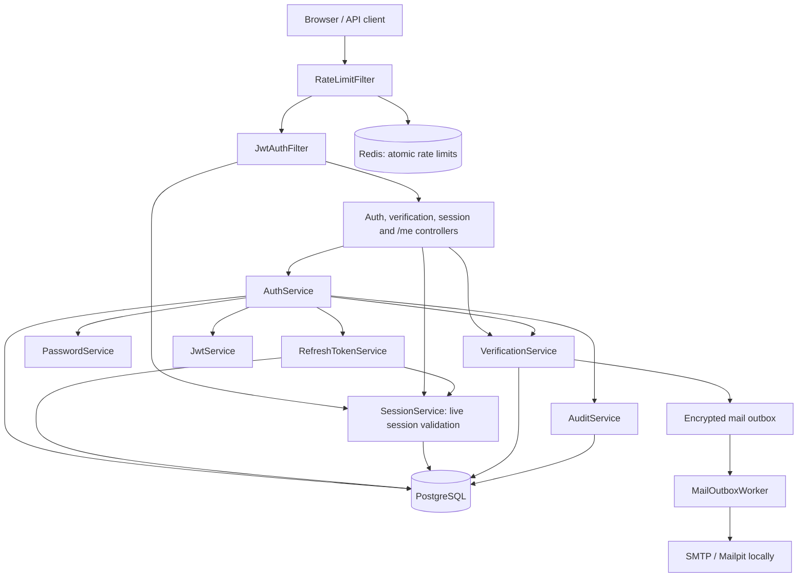
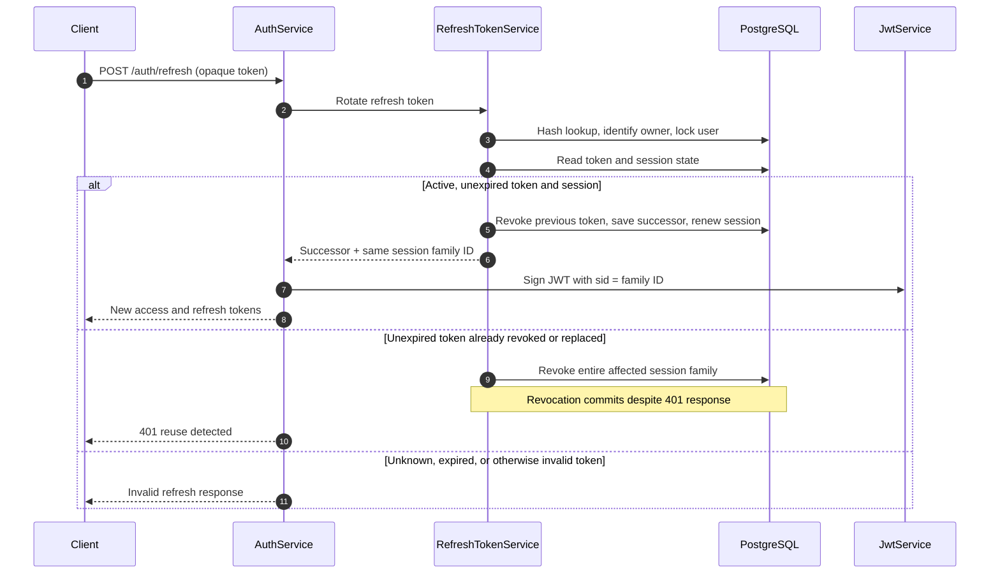

# Secure Auth Service

A security-focused authentication service built with Java 17 and Spring Boot 4, featuring JWT authentication, refresh token rotation, revocable sessions, Redis rate limiting, email verification, password recovery, audit logging, and integration tests.

A hands-on portfolio project illustrating secure authentication patterns with PostgreSQL-backed sessions. **Not a production-ready identity provider.**

[](https://github.com/rahimhashemi/secure-auth-service/actions/workflows/maven.yml)

## Implemented

- BCrypt password hashing and signed, short-lived JWT access tokens.
- Random 384-bit opaque refresh tokens; only peppered hashes are stored.
- Refresh token expiration checks and rotation within a session family.
- Reuse detection that revokes the affected refresh session family.
- Database user-row locks serialize session mutations across application instances.
- Disabled users cannot obtain new tokens through refresh.
- Logout of a refresh token and logout of all refresh sessions using an active refresh token.
- Audit events in independent transactions, including failed login and refresh reuse.
- Swagger UI and a protected `/me` endpoint.
- Shared Redis rate limits for login and refresh, with HTTP 429 and Retry-After.
- Versioned PostgreSQL migrations with Flyway and Hibernate schema validation.
- Active session checks, session listing, selective revocation, and logout of other devices.
- Hashed one-time email verification links with an AES-GCM-encrypted mail outbox and retry worker.
- One-time password recovery links that revoke existing sessions and outstanding reset links.
- TOTP MFA, encrypted per-user seeds, hashed one-time recovery codes and password-authenticated five-minute challenges.
- MFA lifecycle changes revoke existing sessions; password reset does not disable MFA.
- Session-scoped Step-Up reauthentication with a five-minute freshness window for sensitive session revocation, never extended by refresh.

[TOTP MFA architecture, API contracts and operations](docs/totp-mfa.md) · [Step-Up Session](docs/step-up-session.md).

Latest routing/security corrections: [routing and audit repair](docs/auth-routing-and-audit.md).

Platform dependencies and migration notes: [Spring Boot upgrade](docs/spring-boot-upgrade.md).

## Technology stack

| Concern | Implementation |
| --- | --- |
| Application | Java 17, Spring Boot 4.1.2, Spring MVC, Spring Security |
| Authentication | BCrypt, signed HS256 JWT access tokens (JJWT), opaque refresh tokens |
| State and persistence | PostgreSQL, Spring Data JPA, database transactions and row locks |
| Abuse prevention | Redis, atomic Lua-script rate limits |
| Schema management | Flyway migrations, Hibernate schema validation |
| Email verification | Spring Mail, encrypted transactional outbox, Mailpit for local testing |
| Testing and delivery | JUnit, Spring Boot Test, Testcontainers, Maven, Docker Compose, GitHub Actions |

## Architecture

**A package-oriented modular monolith**, running as a single Spring Boot application. Controllers handle HTTP contracts; services coordinate authentication and session changes; repositories persist users, sessions, refresh tokens, audit events, and verification mail. Redis is used for shared rate limiting, **not** as the authoritative session store.



The filters run in sequence; `JwtAuthFilter` skips matched public authentication operations. For requests carrying a Bearer token, the filter verifies the JWT and then checks its `sid` against an active, non-revoked PostgreSQL session and enabled, verified user. This enables revocation on the **next** authenticated request, at the cost of a database lookup per such request. See [session management](docs/session-management.md).

## Authentication flows

### Registration and email verification

`POST /auth/register` normalizes the email, applies the password policy, stores a BCrypt hash, and creates an **unverified** user. A one-time verification token (stored only as a hash) and an AES-GCM-encrypted outbox payload are persisted transactionally. A worker sends the email; `POST /auth/email-verification/confirm` consumes the token and verifies the account. Unverified accounts cannot log in. See [email verification](docs/email-verification.md).

### Password login and token issuance

```mermaid
sequenceDiagram
    autonumber
    participant Client
    participant Filter as RateLimitFilter
    participant Auth as AuthService
    participant Redis
    participant DB as PostgreSQL
    participant Token as RefreshTokenService
    participant JWT as JwtService

    Client->>Filter: POST /auth/login
    Filter->>Redis: Atomically consume IP budget
    Filter->>Auth: Forward request
    Auth->>Redis: Check account failure budget
    Auth->>DB: Load normalized-email user
    Note over Auth: BCrypt verification + enabled and email-verified checks
    alt Invalid credentials
        Auth->>Redis: Record failed login
        Auth-->>Client: 401 (generic credentials error)
    else Valid credentials
        Auth->>Token: Issue new refresh-token family
        Token->>DB: Lock user; store session and token hash
        Token-->>Auth: Opaque refresh token + family ID
        Auth->>JWT: Sign access JWT with sid = family ID
        Auth-->>Client: Access token + refresh token
    end
```

Access JWTs expire after **15 minutes** by default; refresh tokens expire after **14 days**. A successful refresh renews the session lifetime; there is currently **no absolute session lifetime**.

### Refresh rotation and reuse detection



**Client integration requirement:** serialize refresh requests per session (single-flight). Concurrent requests using the *same* refresh token can be interpreted as reuse and revoke their shared session family. Unknown tokens cannot be mapped to a family; expired token history does not revoke a live session. Other device sessions are unaffected by reuse of one family's token. See [session policy](docs/session-policy.md).

## Project structure

```text
src/main/java/com/simpath/app/
├── auth/               # Registration, login, refresh and logout APIs
├── security/           # Password policy, address resolution, Redis rate limits
├── token/
│   ├── token/          # JWT creation, validation filter and principal
│   └── refresh/        # Opaque token hashing, rotation and cleanup
├── session/            # PostgreSQL-backed session listing and revocation
├── verification/       # Email tokens, encrypted outbox, SMTP worker
├── passwordreset/      # One-time password recovery and session revocation
├── mfa/                # TOTP setup, challenges and recovery codes
├── audit/              # Security audit events
├── user/               # User persistence and /me
├── config/             # Spring Security, JWT and OpenAPI configuration
└── common/             # API errors and exception handling

src/main/resources/db/migration/    # Versioned Flyway SQL (V1–V8)
src/main/resources/static/          # Email verification and password reset pages
src/test/java/com/simpath/app/      # Unit, HTTP and Testcontainers tests
docs/                               # Operational and security design notes
.github/workflows/maven.yml         # Java 17/21 Maven verification
```

## Tests and CI

[GitHub Actions – Java CI with Maven](https://github.com/rahimhashemi/secure-auth-service/actions/workflows/maven.yml) runs `mvn -B verify` on **Java 17 and 21** for pull requests and pushes to `master`. Integration tests use real PostgreSQL, Redis and Mailpit via Testcontainers, so Docker must be available. The suite exercises refresh rotation and concurrent reuse, session revocation, rate-limit atomicity, HTTP security filters, email verification/outbox behavior, and Flyway migration safety.

The workflow also includes a **separate dependency-graph submission job** on `master`; if GitHub's Dependency Graph is disabled in repository settings, that job may fail even when both Java build/test jobs pass. Inspect the individual job results instead of interpreting the overall badge as a test-only status. Commands and detailed test coverage are in [Tests](#tests).

## Technical documentation

- [Session management and revocation](docs/session-management.md) · [Session policy](docs/session-policy.md)
- [Email verification architecture](docs/email-verification.md) · [Security hardening](docs/security-hardening.md)
- [Local setup, troubleshooting and functional tests](docs/local-development.md)
- [Routing and audit corrections](docs/auth-routing-and-audit.md) · [Database migration guide](docs/database-migrations.md)
- [Spring Boot upgrade notes](docs/spring-boot-upgrade.md)

## Run locally

Requires Docker Engine / Docker Desktop, Docker Compose v2 and OpenSSL. A host JDK is
needed for Maven tests; the Dockerfile builds the application with Java 17.

### First setup: persist the secrets

Run this once from the repository root for a **new local database**. It creates a
private `.env` file without overwriting an existing one. If the seven secrets are
already exported in this terminal from an earlier run, it preserves those values;
otherwise it generates random hex values.

```bash
if [ -e .env ] || [ -L .env ]; then
  printf 'Existing .env kept; reuse its original secrets.\n'
else
  (
    set -eu
    umask 077
    set -C
    {
      printf 'POSTGRES_PASSWORD=%s\n' "${POSTGRES_PASSWORD:-$(openssl rand -hex 24)}"
      printf 'APP_JWT_SECRET=%s\n' "${APP_JWT_SECRET:-$(openssl rand -hex 32)}"
      printf 'APP_REFRESH_PEPPER=%s\n' "${APP_REFRESH_PEPPER:-$(openssl rand -hex 32)}"
      printf 'APP_RATE_LIMIT_ACCOUNT_KEY=%s\n' "${APP_RATE_LIMIT_ACCOUNT_KEY:-$(openssl rand -hex 32)}"
      printf 'APP_MAIL_OUTBOX_KEY=%s\n' "${APP_MAIL_OUTBOX_KEY:-$(openssl rand -hex 32)}"
      printf 'APP_MFA_ENCRYPTION_KEY=%s\n' "${APP_MFA_ENCRYPTION_KEY:-$(openssl rand -hex 32)}"
      printf 'APP_MFA_RECOVERY_PEPPER=%s\n' "${APP_MFA_RECOVERY_PEPPER:-$(openssl rand -hex 32)}"
      printf 'APP_API_DOCS_ENABLED=true\n'
    } > .env
  )
fi
```

**Existing installation:** reuse the original values. On an existing pre-MFA install,
add two *new* independent secrets to `.env` without replacing the old ones:

```bash
grep -q '^APP_MFA_ENCRYPTION_KEY=' .env || printf 'APP_MFA_ENCRYPTION_KEY=%s\\n' "$(openssl rand -hex 32)" >> .env
grep -q '^APP_MFA_RECOVERY_PEPPER=' .env || printf 'APP_MFA_RECOVERY_PEPPER=%s\\n' "$(openssl rand -hex 32)" >> .env
chmod 600 .env
```

If you have lost the exports,
recover the existing container settings before generating replacements; see
[environment and database recovery](docs/local-development.md#environment-and-database-recovery).
`.env.example` lists the supported settings; `.env` is excluded from Git.

Validate the configuration without displaying its secrets, then start the services:

```bash
docker info
docker compose config --quiet
docker compose up --build -d
docker compose ps
curl --fail --silent --show-error \
  --retry 20 --retry-delay 2 --retry-connrefused --retry-max-time 60 \
  http://localhost:8081/actuator/health
```

Wait for `Started AuthServiceApplication` in `docker compose logs --tail=100 app`
and an HTTP 200 health response with `status: UP`.

### Subsequent runs

Keep `.env` and the database data across runs. Compose reads the file automatically,
including in a new terminal:

```bash
docker compose up -d
docker compose logs --tail=100 -f app
```

After application source changes, use `docker compose up --build -d`.
Shell environment variables override values in `.env`; remove stale exports when
switching to the saved configuration. Replacing the PostgreSQL password in `.env`
does not change the password already stored in an initialized database.

### Local addresses

Open these URLs **on the computer running Docker**:

| Service | Address / purpose |
| --- | --- |
| API | http://localhost:8081 |
| Swagger UI | http://localhost:8081/swagger-ui.html |
| Health | http://localhost:8081/actuator/health |
| Mailpit inbox | http://localhost:8025 |
| PostgreSQL | localhost:5433, database `authdb`, user `auth` |
| Redis | localhost:6379 |
| SMTP inside Compose | `mailpit:1025`; application uses this by default |

Mailpit captures local test email, including messages addressed to Gmail or other
real email addresses. Read verification and recovery links in the Mailpit inbox.
Real external delivery requires your own SMTP provider configuration.

Swagger is enabled by default in local Compose; set `APP_API_DOCS_ENABLED=false`
to disable it. The exposed ports bind to loopback. Redis is required for the rate
limits; Compose waits for PostgreSQL and Redis health checks.

The seven secrets have different roles: PostgreSQL credentials, JWT signing,
refresh-token hashing, account rate-limit HMACs, outbox encryption, TOTP seed encryption and recovery-code HMAC hashing. Keep them stable.
Changing the JWT key invalidates access tokens; changing the refresh pepper invalidates
refresh tokens; replacing the outbox key makes queued encrypted email unreadable.
See the [local runbook](docs/local-development.md) for Docker Desktop, registry access,
Lombok and startup troubleshooting.

## API examples

```bash
curl -X POST localhost:8081/auth/register \
  -H 'Content-Type: application/json' \
  -d '{"email":"test@example.com","password":"Correct-Horse-123!"}'

# Before login: open http://localhost:8025, follow the verification link
# for this email address and press Confirm email. Expected confirmation: HTTP 204.
# Login before verification returns HTTP 401 INVALID_CREDENTIALS.
curl -X POST localhost:8081/auth/login \
  -H 'Content-Type: application/json' \
  -d '{"email":"test@example.com","password":"Correct-Horse-123!"}'

curl localhost:8081/me -H 'Authorization: Bearer <ACCESS_TOKEN>'

curl -X POST localhost:8081/auth/refresh \
  -H 'Content-Type: application/json' \
  -d '{"refreshToken":"<REFRESH_TOKEN>"}'

curl -X POST localhost:8081/auth/logout \
  -H 'Content-Type: application/json' \
  -d '{"refreshToken":"<REFRESH_TOKEN>"}'
```

`POST /auth/logout-all` accepts the same request body and requires an active,
unexpired refresh token.

## Token and transaction behavior

Access tokens expire after 15 minutes by default. Refresh tokens expire 14 days
after issuance; rotation renews that lifetime. There is no absolute session lifetime.

A reused, unexpired refresh token revokes **its session family**. Other devices remain
active. Expired history is rejected without revocation. Family revocation commits even
though the request returns 401. Clients must serialize refresh requests:
two concurrent requests using the same token cause one rotation and then reuse
revocation, so the returned successor is also revoked.

Access JWTs carry a required `sid`. Every authenticated request checks the session
and the user's enabled state in PostgreSQL. Logout, family reuse revocation and
logout-all invalidate the corresponding access tokens on the next request. A request
already authorized and running may finish. See [session management](docs/session-management.md).

Audit entries use independent transactions. Success entries describe an attempted
operation and can remain if the surrounding transaction subsequently fails.

## Login and refresh rate limits

By default each socket peer IP gets separate budgets of **10 login attempts** and
**30 refresh attempts** in a **60-second fixed window**, starting at the first request.
All POST attempts count, including successful, invalid, and malformed requests.
Registration has a separate default limit of 5 requests per IP/window. Verification request/confirmation endpoints have separate IP budgets too. Redis executes the check, increment, and expiry
atomically so multiple application instances share the same budget. Redis keys use
SHA-256 of the address and never include passwords, email addresses, or tokens.
An address hash is pseudonymous, not anonymous.

- Exhausted budget: `429`, JSON code `RATE_LIMIT_EXCEEDED`, and `Retry-After` in seconds.
- Redis failure: `503`, JSON code `RATE_LIMIT_UNAVAILABLE`; login and refresh fail closed.
- Rejected attempts do not extend the window. Budget resets when the Redis key expires.
- Fixed windows allow bursts near window boundaries; this is not a sliding-window limiter.
- Redis command and connect timeouts default to one second each.

Configuration (also forwarded by Compose):

| Environment variable | Default |
| --- | --- |
| `APP_RATE_LIMIT_ENABLED` | `true` |
| `APP_RATE_LIMIT_LOGIN_LIMIT` | `10` |
| `APP_RATE_LIMIT_REFRESH_LIMIT` | `30` |
| `APP_RATE_LIMIT_WINDOW_SECONDS` | `60` |

Limits must be positive and window size must be 1..86400 seconds. Disabling the
limiter explicitly bypasses Redis checks. All instances must use the same Redis
database and settings. Redis restarts, eviction, or data loss can reset budgets.

Automatic forwarded-header processing is disabled. `X-Forwarded-For` is ignored unless
the peer is explicitly listed in `APP_TRUSTED_PROXIES` and supplies one literal client IP. Behind a reverse proxy, requests share the proxy address budget until
trusted-ingress address handling is deliberately configured. Clients sharing a NAT
also share a budget. IP rotation/distributed attacks can bypass IP-only limits; an additional normalized-account
login budget now limits failed attempts across IPs; successful logins do not consume or reset it. Edge protection remains necessary. No account lockout is
implemented. Do not enable arbitrary forwarded-header trust on an internet-facing app.

## Database migrations

On an empty database, Flyway creates the auth tables from the versioned SQL
under `src/main/resources/db/migration`; Hibernate then validates the schema instead
of changing it. Applied migration checksums are checked on startup. Automatic baseline
and Flyway clean are disabled.

**Existing databases created by Hibernate need a deliberate adoption step.** Startup
will refuse an unmanaged nonempty schema. Follow [the migration guide](docs/database-migrations.md)
to compare the schema, preserve data and explicitly baseline a verified version 1.
A baseline records history; it does not repair schema differences.

## Tests

Use a host **JDK 17 or 21**, the versions covered by CI, and a working Docker daemon:

```bash
bash mvnw -v
docker info
bash mvnw -B clean verify
```

On **Linux with Docker Desktop**, explicitly select its socket if Testcontainers
cannot discover it:

```bash
DOCKER_HOST="unix://$HOME/.docker/desktop/docker.sock" \
TESTCONTAINERS_DOCKER_SOCKET_OVERRIDE=/var/run/docker.sock \
bash mvnw -B clean verify
```

Testcontainers starts its own disposable PostgreSQL, Redis and Mailpit containers.
It uses test configuration independently of Compose and the application's saved
secrets. It still needs access to every test image, including Ryuk; changing image
names in `compose.yaml` or `Dockerfile` does not update the test images.

A successful verification ends with `BUILD SUCCESS` and no test failures or errors.
Check that the integration tests actually ran. A successful `test-compile` only
confirms compilation. The initial run may take longer while downloading Maven
dependencies and images.

For filter regression tests without Docker:

```bash
bash mvnw -B -Dtest=JwtAuthFilterTest,RateLimitFilterTest test
```

If Lombok-generated methods such as `AuditEvent.setType` cannot be found, check the
JDK shown by `bash mvnw -v`. The current POM relies on annotation processor discovery;
JDK 23+ requires explicit activation. See
[Lombok compilation troubleshooting](docs/local-development.md#lombok-compilation).

The integration suite covers refresh rotation/reuse and concurrency, immediate
session revocation, email verification and encrypted mail delivery, one-time password
reset and revocation of existing sessions, Redis rate-limit atomicity, HTTP filters,
and Flyway migration safety. It runs migrations with production Hibernate validation.
The suite does not silently skip database tests when Docker is absent.

See [authentication hardening](docs/security-hardening.md) for throttling, trusted
proxy configuration, generic responses, password policy and cleanup, and the
[manual functional checks](docs/local-development.md#manual-functional-checks)
for the expected HTTP responses.

## Remaining limitations

- TOTP MFA, MFA recovery codes, Step-Up sessions and OAuth2/OIDC are not implemented yet.
- Existing Hibernate databases require verified, manual Flyway adoption; separate migration/runtime DB roles are not configured.
- Access tokens are checked against PostgreSQL sessions on every authenticated request. Expired history is cleaned in bounded batches.
- Database locks serialize session operations per user, with no custom lock timeout policy.
- Registration normalization/concurrency behavior and broader HTTP endpoint coverage need work.
- Deployment hardening, TLS, browser credential storage and CSRF policy require a deployment-specific review.


## Manage sessions

`GET /sessions?page=0&size=20` lists your active sessions (maximum size 100), including
creation/last activity times, initial IP/user agent, expiry and a `current` flag.
`DELETE /sessions/{id}` revokes one of your sessions; `DELETE /sessions/others` keeps
only the calling session. Both return 204. Supply an access token in the Bearer header.
Unknown or another user's session id returns the same 204 without changing that user.

**V4 deployment cutover:** stop old instances before migrating and start only the
new version afterwards. V4 revokes legacy refresh tokens; JWTs without `sid` are
rejected. All existing users must sign in again. Do not run old and new versions
concurrently or roll back the binary: old binaries do not enforce session revocation.

## Email verification

Registration creates an unverified account. On the machine running Docker, open
[Mailpit](http://localhost:8025), find **Verify your email - Secure Auth Service**
for that exact recipient, follow the link and press **Confirm email**. Allow at least
one worker poll (normally about ten seconds) for delivery. Then log in.

For direct API confirmation, send only the **43-character token after `#token=`**
in the email link as the JSON `token` value. The confirmation page removes the
fragment from the address bar on load; copy from the email itself. Verification
tokens expire after 30 minutes and can be used once. Successful confirmation returns
204 with no body. Invalid, expired or already-consumed tokens, and an already-verified
or disabled account, return the same `INVALID_VERIFICATION_TOKEN` error.

`POST /auth/email-verification/request` accepts an `email` field and returns a
generic 202. That response does not prove an account exists or email was delivered.
The account must exist, be enabled and remain unverified. A one-minute per-user
cooldown and separate IP/account budgets apply. Duplicate registration neither
changes the original password nor queues another email. Request verification for an
existing unverified account rather than registering it again.

**V5 cutover:** existing users must verify before signing in; legacy sessions and
refresh tokens are revoked. Drain old instances before migration. Existing users
request verification explicitly; the migration does not send a mail blast.

For external delivery configure SMTP and an HTTPS `APP_VERIFICATION_PUBLIC_URL`.
See [verification architecture](docs/email-verification.md) and the
[local email troubleshooting guide](docs/local-development.md#email-verification).

### Password reset

Send `POST /auth/password-reset/request` with an `email` field. Eligible accounts
receive a 15-minute link via the same encrypted outbox used for verification.
For local Compose, open Mailpit at http://localhost:8025 to find the link.
The reset page is a sibling of the configured verification page.

The page sends `POST /auth/password-reset/confirm` with `token` and `newPassword`.
A successful reset returns 204, revokes existing sessions and outstanding reset
links, and queues a confirmation email. Sign in again with the new password.
